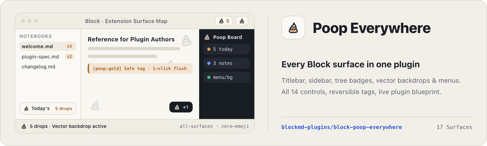

<picture>
  <source media="(prefers-color-scheme: dark)" srcset="assets/card-en-dark.png">
  <source media="(prefers-color-scheme: light)" srcset="assets/card-en-light.png">
  
</picture>

A lighthearted prank plugin and official Block showcase (much like VS Code's official sample extensions).

- **Leave marks everywhere**: Drop marks across the top bar, the "Today's Drops" sidebar list and file badges, editor watermark backdrops (with dark-mode glow), the right-hand Poop Board counter, the bottom status bar, and right inside your notes or selected text.
- **Flush clean anytime**: Click Flush and confirm when you are done -- it clears every mark and resets all counters to zero without touching any of your own writing.
- **Simple to jump in**: Settings keep only the 3 everyday options (drop count, backdrop toggle, and caption), while the side panel lets you switch backdrop styles, view stats, and jump straight to marked notes.

For developers curious about building Block plugins, this also serves as an official hands-on showcase of every UI surface in one place.

**Install**: Open Block Settings -> App Store and search **Poop Everywhere**, or enter `blockmd-plugins/block-poop-everywhere`.
