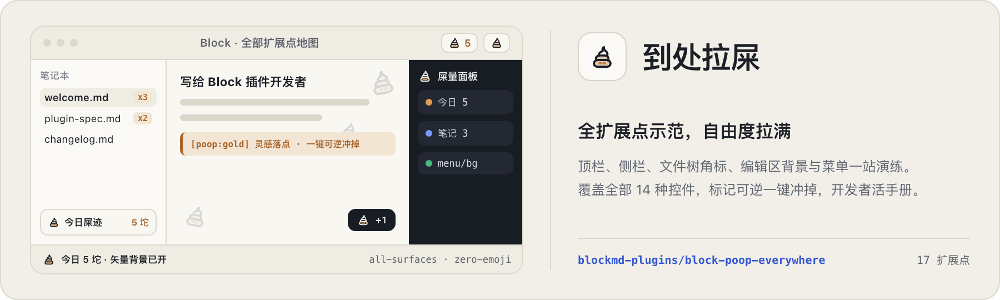

<picture>
  <source media="(prefers-color-scheme: dark)" srcset="assets/card-zh-dark.png">
  <source media="(prefers-color-scheme: light)" srcset="assets/card-zh-light.png">
  
</picture>

一个轻松恶搞的趣味彩蛋插件，也是 Block 的官方插件能力展示厅（类似 VS Code 的官方示例扩展）。

- **全界面到处留痕**：一键就能在顶栏按钮、左侧栏「今日屎迹」与文件角标、编辑区水印背景（暗色模式还会夜光）、右侧「屎量面板」计数器、底部状态栏，以及笔记正文的光标或选区里留下印记。
- **随时一键冲水**：玩够了点一下「冲水」并确认，所有标记和角标都会瞬间清零，只清理插件留下的痕迹，完全不伤你原本写的笔记内容。
- **轻量好上手**：常用设置只保留每次数量、背景开关和自定义附言 3 项，开箱就能整活；打开右侧面板还能切背景款式、看战绩并一键跳回对应笔记。

想自己写 Block 插件的开发者，也可以把它当作官方全界面位置示例来参考。

**安装**：打开 Block「设置 → 应用商店」搜索 **到处拉屎**，或手动填入 `blockmd-plugins/block-poop-everywhere`。
